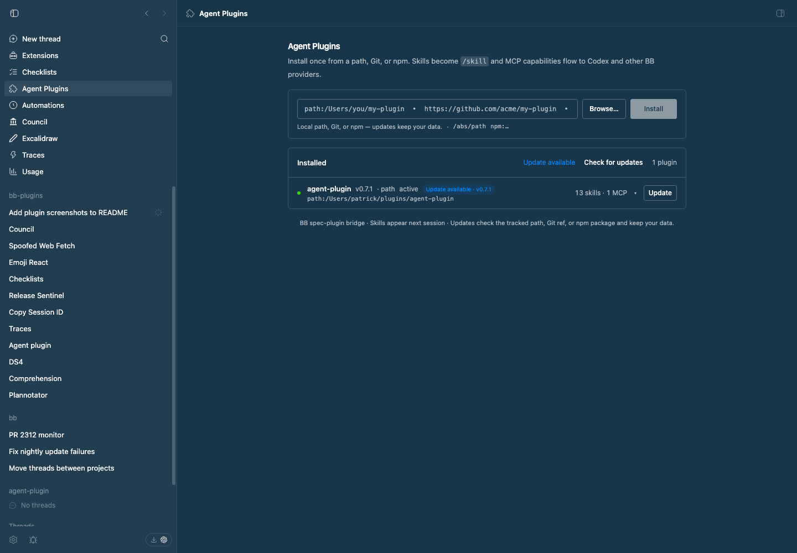

# Agent Plugins for VesnALIA

> Install from the [VesnALIA Community marketplace](https://github.com/get-bb/marketplace/pull/84) (entry pending review).

Install [Agent Plugins](https://agent-plugins.org) once in VesnALIA and use them everywhere — skills become `/skill` commands and MCP capabilities flow to Codex and other VesnALIA providers through one canonical bridge.

This is the Agent Plugins/spec-plugin integration for VesnALIA. It is not a Claude marketplace plugin and does not publish to, install from, or emulate Claude's marketplace.

Supports local paths, Git, and npm. MCP stdio, Streamable HTTP, and legacy SSE are handled by the official `@modelcontextprotocol/client` SDK.

## Staged preview



Captured from the running VesnALIA application with a live installed-plugin record.

## Install

```sh
# from the alia-plugins workspace
pnpm install
alia plugin build packages/alia-plugin-agent-plugins
alia plugin install ./packages/alia-plugin-agent-plugins --yes
```

Or install directly from git:

```sh
alia plugin install git:https://github.com/patleeman/bb-plugins.git --subdirectory packages/alia-plugin-agent-plugins --yes
```

## Use

- **UI:** Open **Agent Plugins** in the sidebar → paste a location (`/abs/path`, `https://github.com/acme/my-plugin`, `npm:my-plugin@^1.0`) or **Browse…** for a local folder → **Install**. The page checks tracked paths, Git refs, and npm sources for updates; an installed row shows **Update available** and an explicit **Update** button when the source changes. Expand an installed plugin to enable or disable each skill and MCP server independently. Disabled skills are not materialized for the next session; disabled MCP servers are removed from the bridge catalog while their approval is preserved. Supported MCP servers still need **Approve & start**; OAuth-protected HTTP servers use VesnALIA's loopback callback and expose **Authenticate**, **Reconnect**, **Reauthorize**, and **Disconnect** controls. Reconnect reuses or refreshes stored credentials; Reauthorize clears VesnALIA's local credentials and starts a fresh consent flow; Disconnect clears VesnALIA's local credentials and stops the connection. Remote grant revocation remains provider-dependent.
- **CLI:** `alia agent-plugins list --json` · `alia agent-plugins outdated --json` · `alia agent-plugins update <id>` · `alia agent-plugins show <id> --json` · `alia agent-plugins tools --json` · `alia agent-plugins tools --query "search logs" --server datadog` · `alia agent-plugins describe <opaqueId>` · `alia agent-plugins call <opaqueId> '{"text":"hello"}'`
- **Agents:** the bridge exposes `agent_plugins_list_tools`, `agent_plugins_describe_tool`, and `agent_plugins_call`. `agent_plugins_list_tools` searches the catalog (`query`, `serverId`, `limit`, `offset`) and returns compact entries without input schemas, plus a tool count per server, so large servers don't flood the context. Agents fetch schemas for the tools they pick with `agent_plugins_describe_tool`, then call them by opaque ID.

The MCP client delegates authentication to the official SDK, including protected-resource/authorization-server discovery, dynamic client registration, PKCE, refresh, `WWW-Authenticate`, insufficient-scope step-up, and OAuth callback completion. Tokens and PKCE state are stored in a VesnALIA secret setting; they are never placed in the database snapshot or frontend payload.

This v0 release installs one package instance at a time. Remove an existing
plugin before installing the same package name again; removal keeps its data
unless you choose to purge it.

## Spec

Implements Agent Plugins 1.0.0 + 1.1.0 draft (tolerant closed `plugin.json`, per-server `mcp.json` isolation, `skills/` discovery, `${PLUGIN_ROOT}`/`${PLUGIN_DATA}` single-pass, `cwd` containment, header/CRLF checks). MCP tools, prompts, resources, resource templates, completions, subscriptions, structured tool output, metadata, and lifecycle/list-changed notifications are forwarded through the SDK gateway. The bridge advertises only VesnALIA capabilities it can answer; it does not claim sampling, elicitation, or roots until VesnALIA exposes those host callbacks. Vendored schemas are in `schemas/`.

## Development

```sh
pnpm --filter alia-plugin-agent-plugins typecheck
pnpm --filter alia-plugin-agent-plugins test
alia plugin build packages/alia-plugin-agent-plugins
```
