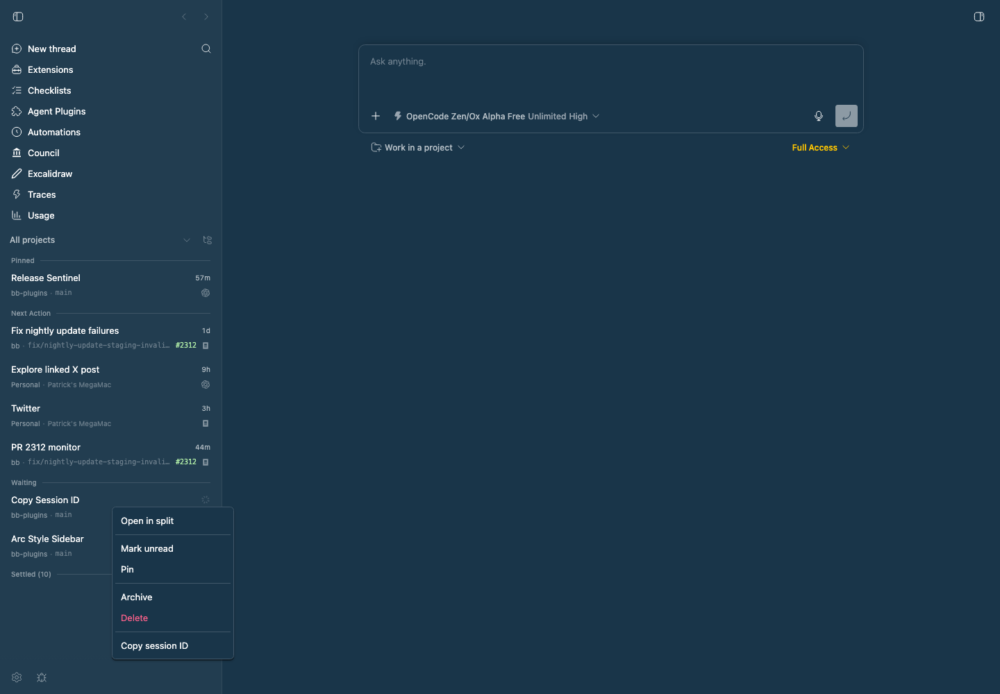

# Copy Session ID

> Install from the [VesnALIA Community marketplace](https://github.com/get-bb/marketplace/pull/88) (entry pending review).

This plugin adds **Copy session ID** to the context menu for thread rows in
VesnALIA's left sidebar. It copies the row's VesnALIA thread/session identifier to the
clipboard and shows a success or error toast.

The built-in sidebar stays in place. The plugin uses VesnALIA's trusted frontend
content-script surface to add the item after the host menu opens, and removes
its DOM nodes, observers, listeners, and timers when the plugin reloads or is
disabled.

## Staged preview

Captured from the running VesnALIA application after opening a real thread menu.
The staged menu shows the text-only action aligned with the host's native menu
items.

## Development

From the repository root:

    pnpm install
    pnpm --filter alia-plugin-copy-session-id typecheck
    pnpm --filter alia-plugin-copy-session-id test
    pnpm --filter alia-plugin-copy-session-id build

Install the local plugin into the running VesnALIA instance with:

    VesnALIA plugin install ./packages/alia-plugin-copy-session-id --yes

After source changes, rebuild and reload:

    VesnALIA plugin build ./packages/alia-plugin-copy-session-id
    VesnALIA plugin reload copy-session-id

The menu item depends on the host's stable
data-sidebar-thread-id row attribute. The implementation also accepts
data-thread-id and data-session-id for compatibility with older host markup.
