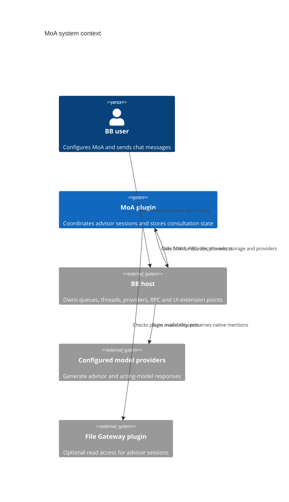
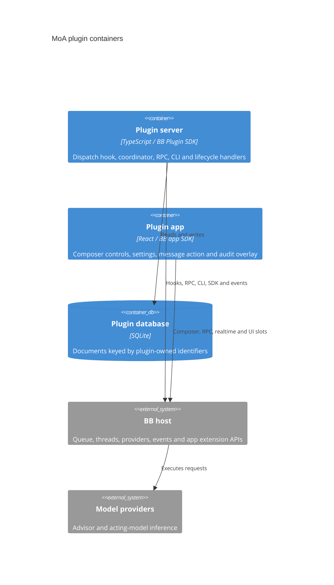
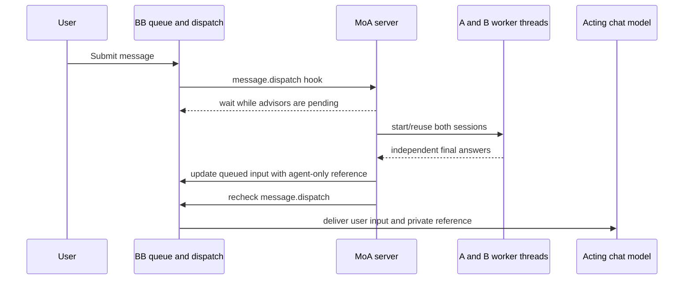
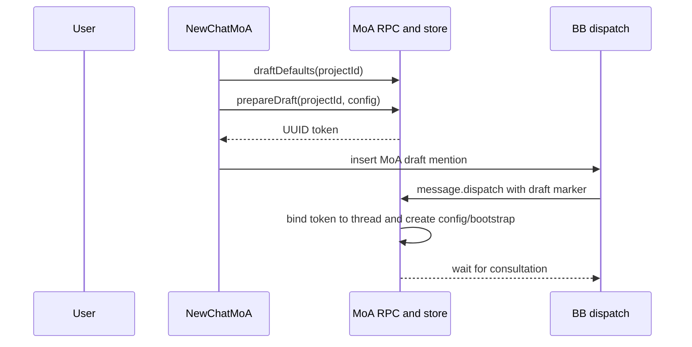

# Architecture

TL;DR: The BB plugin server gates message dispatch, stores MoA state, runs two advisor workers, and enriches the queued message with private advice. The plugin app configures that behavior and inspects its recorded runs through typed RPC. (server.ts:27-33, server.ts:113-153, app.tsx:171-195)

## System Context

## Containers

## Building Blocks

- `plugin` in `server.ts` initializes the durable store and audit helper, derives config and host routing, and registers dispatch admission, consultation processing, RPC, CLI, mention resolution, events, and background work. (server.ts:27-89, server.ts:113-153, server.ts:431-546)
- `contract.ts` defines Zod input/output schemas and the typed RPC names. (contract.ts:4-53, contract.ts:55-89)
- `store.ts` maps plugin values to the `documents` SQLite table. See [Data model](data-model.md) for ownership and lifecycle. (store.ts:12-32)
- `core.ts`, `prompts.ts`, and `file-access.ts` create the private reference, advisor instructions, and optional native gateway mentions. (core.ts:17-28, prompts.ts:2-23, file-access.ts:4-27)
- `app.tsx` selects new-chat versus existing-chat controls and registers settings, message actions, overlay, and composer extension points. (app.tsx:171-195)

## Key Flows

### Existing chat consultation

The hook permits MoA-originated messages, rejects multiple or misbound new-chat tokens, and holds enabled messages until matching advice exists. The coordinator checks that the queued content, acting model, and configuration revision still match before enriching the queue. (server.ts:113-153, server.ts:311-323)

### New-chat first message

`NewChatMoA` loads project defaults or the bound token config, calls `prepareDraft`, then inserts a structured mention. The server rejects a token from another project/thread and creates thread config plus bootstrap routing on the first dispatch. (new-chat.tsx:11-70, server.ts:116-131, server.ts:442-470)

### UI control and RPC

`ComposerMoA` chooses `NewChatMoA` only for a `new-thread` scope; all other composer scopes use `MoAControl`. The latter loads `status`, saves via `save`, toggles the chat via `toggle`, and requests retry or audit through RPC. The same control is wrapped in BB’s dialog trigger, whose compact viewport implementation uses click handling. (app.tsx:61-120, app.tsx:193-195, new-chat.tsx:71-85, components/ui/responsive-overlay.tsx:157-225)

The RPC contract exposes `messageIndex`, `audit`, `replaceParticipant`, `draftDefaults`, `prepareDraft`, `readDraft`, `status`, `save`, `toggle`, `retry`, `providers`, and `models`. Their Zod input and output shapes are declared in `contract.ts:55-89`; server handlers are registered in `server.ts:431-489`. Configuration validation rejects identical A/B models, missing required reserve models, reserve collisions, unavailable models, and unsupported reasoning levels. (server.ts:388-405)

## Invariants

- A and B are independent: both attempts receive the same canonical context and the fresh peer proposal is not shared. (server.ts:297-303)
- The reference is an `agent-only` text block tagged with a run UUID; the acting model is instructed to evaluate advice rather than treat it as authority. (core.ts:17-28, prompts.ts:22-23)
- Before queue enrichment, the coordinator verifies the run fingerprint against current queued input, main model, and settings revision. (server.ts:98-105, server.ts:311-323)
- Draft tokens are bound to their project and, after initial dispatch, their receiving thread. (server.ts:116-131, server.ts:459-470)
- Advisor workers inherit the originating message permission mode, with `accept-edits` as the fallback when no mode is present. (server.ts:209-218)
- The timeout setting controls the overdue indicator for active work; it does not stop an active, starting, or pending advisor. Errors and explicit cancellation are handled separately. (server.ts:229-255)

## Cross-cutting concerns

**Persistence:** `createStore` serializes typed plugin values as JSON in SQLite; BB storage migrations create the table and index. (store.ts:12-32)

**Errors and recovery:** Participant failures follow `wait`, `reserve`, or `available`; failed runs remain associated with the queued message for explicit retry or a settings change. (server.ts:276-294, server.ts:303-326, server.ts:419-429)

**Audit:** The audit correlates an agent-only reference UUID in BB request events to a stored run, with request event pagination capped at 5 pages of 100. (audit.ts:16-38, audit.ts:41-70)

**File access:** Each attempt checks whether the File Gateway plugin is enabled and running. Without it, advisor input omits external-source mentions; with it, native File Gateway resources are preserved for BB resolution. (file-access.ts:4-27, server.ts:193-200)

<!-- lane-pilot:backlinks -->
## Referenced by

- [Mixture of Agents overview](overview.md)
