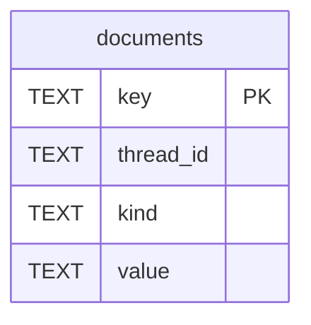

# Data model

TL;DR: MoA persists all plugin-owned records as JSON documents in one SQLite table. The `kind` column distinguishes configs, shared settings, drafts, bootstrap state, runs, sessions, and queue-to-run links; the JSON payload carries each record’s domain fields. (store.ts:12-32, server.ts:33-60)

## Schema overview

## Tables

### `documents`

Purpose: durable key/value storage for all MoA state. `key` is the unique plugin identifier; `thread_id` and `kind` are lookup dimensions; `value` is serialized JSON. The `(thread_id, kind)` index supports bounded per-chat listings. (store.ts:14-17, store.ts:23-29)

| Column | Meaning | Constraint / source |
|---|---|---|
| `key` | Plugin-owned identity for a document; examples include `config:<threadId>`, `run:<runId>`, and hashed `session:` keys. | Primary key; supplied to `put` by the server. (store.ts:23-25, server.ts:59, server.ts:175) |
| `thread_id` | Chat scope used to list records for one thread. Shared settings use the literal `global`; drafts initially use their project until bound to a thread. | Required text; passed to `put`. (store.ts:23-25, server.ts:47, server.ts:464) |
| `kind` | Record category used by `list(threadId, kind)`. | Required text; code uses `config`, `settings`, `draft`, `bootstrap`, `run`, `session`, and `queue`. (store.ts:27-29, server.ts:47, server.ts:127-129, server.ts:381) |
| `value` | JSON serialization of the typed record. | Required text; `JSON.stringify` on write and `JSON.parse` on read. (store.ts:20-29) |

The migration creates the table and `documents_thread_kind` index. There are no declared foreign keys, status columns, or database-level deletion policies. (store.ts:14-17)

## Stored document kinds

The `kind` value selects a JSON record shape; it is not a separate SQL table. Types are declared in `store.ts:5-11` and run/member output shapes in `contract.ts:28-45`.

| Kind / key pattern | Meaning and principal fields | Writers and readers |
|---|---|---|
| `config` / `config:<threadId>` | Chat settings plus `revision`; `enabled` is chat-specific. | `saveConfig` writes; `configured`, status, dispatch and UI RPC read. (server.ts:33-40, server.ts:407-413) |
| `settings` / `global:settings` | Shared settings without `enabled`, plus pair revision. | `saveShared` writes; `configured`, new-chat defaults and shared settings RPC read. (server.ts:34, server.ts:42-53) |
| `draft` / `draft:<uuid>` | Draft config, `projectId`, and nullable bound `threadId`. | `prepareDraft` writes; mention resolver, `readDraft`, and dispatch admission read/update. (server.ts:116-131, server.ts:459-470, server.ts:490-493) |
| `bootstrap` / `bootstrap:<threadId>` | Existing host and main model routing before the chat environment exists. | First-message admission writes; `routing` and `mainSlot` read. (server.ts:63-73, server.ts:75-89, server.ts:124-129) |
| `run` / `run:<uuid>` | Queue consultation snapshot: status, A/B member attempts, advice, error, timestamps, fingerprint, settings revision, input, queue ID, and permission mode. | `scan` and consultation helpers write; dispatch hook, retry, status, CLI, audit and UI read. (server.ts:59, server.ts:297-326, server.ts:338-385, server.ts:415-429) |
| `session` / `session:<threadId>:<hash>` | Advisor worker thread ID, conversation cursor, and environment ID; key also hashes model slot, participant and prompt version. | `requestAdvice` creates/migrates and advances cursor; subsequent attempts reuse; thread archive/delete handler cleans up workers. (server.ts:175-188, server.ts:223-226, server.ts:257-262, server.ts:534-539) |
| `queue` / `queue:<queueId>` | Link from a BB queued-message ID to the corresponding run ID. | `scan` and retry write; `runFor` reads; no explicit cleanup is defined. (server.ts:55-58, server.ts:381, server.ts:427-428) |

## Status lifecycles

Status is stored inside the JSON `run` and member-attempt payloads. The schemas enumerate allowed values. (contract.ts:28-45)

### Run status

| From | To | Function at file:line | When |
|---|---|---|---|
| absent | waiting | `scan` (`server.ts:374-381`) | A queued input has no current matching run. |
| waiting | running | `consult` (`server.ts:297-303`) | Participant work starts. |
| running | failed | `consult` (`server.ts:303-309`, `server.ts:324-327`) | A participant failed and partial continuation is not allowed, or coordinator work throws. |
| failed | waiting | `scan` (`server.ts:353-359`) | A configured reserve or available-answer policy can recover the failed run. |
| failed | waiting | `retry` (`server.ts:419-429`) | Explicit retry makes a new run ID and retains ready member results. |
| running | ready | `consult` (`server.ts:311-320`) | At least the permitted answers are collected and queue state still matches. |
| ready | dispatched | `message.dispatched` (`server.ts:527-532`) | BB dispatch includes this run’s reference and stored advice. |
| any active run | cancelled | queue mismatch in `consult` (`server.ts:311-315`), `message.cancelled` (`server.ts:523-526`), or settings change (`server.ts:408-413`) | Input/configuration changed or the user/host cancelled. |
| queued run | bypassed | `message.dispatched` (`server.ts:527-533`) | BB dispatched without the MoA reference, including Send now. |

### Participant status

| From | To | Function at file:line | When |
|---|---|---|---|
| absent / waiting | running | `requestAdvice` (`server.ts:155-168`) | An advisor attempt starts. |
| running | ready | `requestAdvice` (`server.ts:256-262`) | A non-empty output is collected. |
| running | failed | `requestAdvice` (`server.ts:263-267`) | An error occurs before successful completion. |
| failed | waiting | `consultMember` (`server.ts:284-292`) | Reserve replaces the failed participant. Previous attempt is appended to `attempts`. |
| running | cancelled | `requestAdvice` (`server.ts:268-272`) | Explicit cancellation aborts unfinished participant work. |
| running | failed | `scan` (`server.ts:366-370`) | Plugin reload interrupts a persisted active run; work is not replayed automatically. |

`progress.state` records the BB runtime display status, while `overdue` means elapsed time passed the configured notice threshold; it is not a lifecycle state and does not cancel active work. (contract.ts:24-27, server.ts:229-255)

`progress.state` is a status-like snapshot sourced from `worker.runtime.displayStatus` or `worker.status`. MoA replaces the snapshot while polling; it does not define a closed list of BB runtime values or a separate transition machine. (server.ts:231-244)

## Invariants

- The table key is unique; `put` updates only `value` on conflict, leaving the original `thread_id` and `kind` unchanged. (store.ts:23-25)
- `list` returns at most 100 newest rows for a `(thread_id, kind)` pair. (store.ts:27-29)
- `configSchema` clears legacy `agentId` selections; A/B and reserve model comparisons use provider ID plus model name. (contract.ts:5-23, core.ts:12-16)
- Run records contain the exact input snapshot and fingerprint used to determine whether the queued message is still current. (store.ts:8, server.ts:98-105, server.ts:375-379)

## Writers, readers, retention, and cleanup

The plugin server is the only code that writes `documents`; UI and CLI access records through RPC. Audit reads stored run snapshots and BB request events; it does not mutate the table. (store.ts:18-32, server.ts:431-521, audit.ts:41-70)

There is no per-record expiry or pruning job. `list` limits each query to 100 rows but does not delete older rows. On chat archive or delete, MoA stops and archives session worker threads; the handler does not delete stored runs, settings, queue links, drafts, or session documents. (store.ts:27-32, server.ts:534-539)

## Migrations and ownership

`createStore` registers the `documents` table and its thread/kind index through `bb.storage.migrate`. The schema is owned by the MoA plugin’s `store.ts`; record meanings and writes are coordinated by `server.ts`. (store.ts:12-17, server.ts:27-29)

<!-- lane-pilot:backlinks -->
## Referenced by

- [Architecture](architecture.md)
- [Mixture of Agents overview](overview.md)
