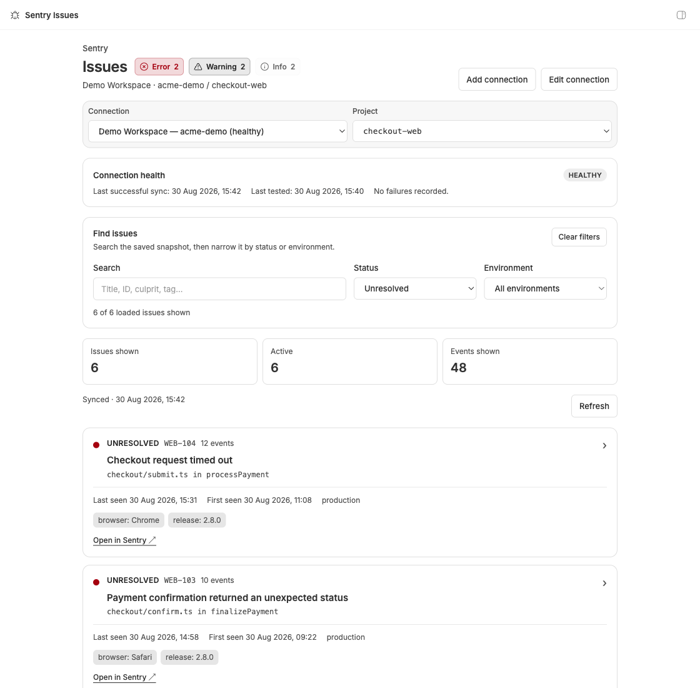
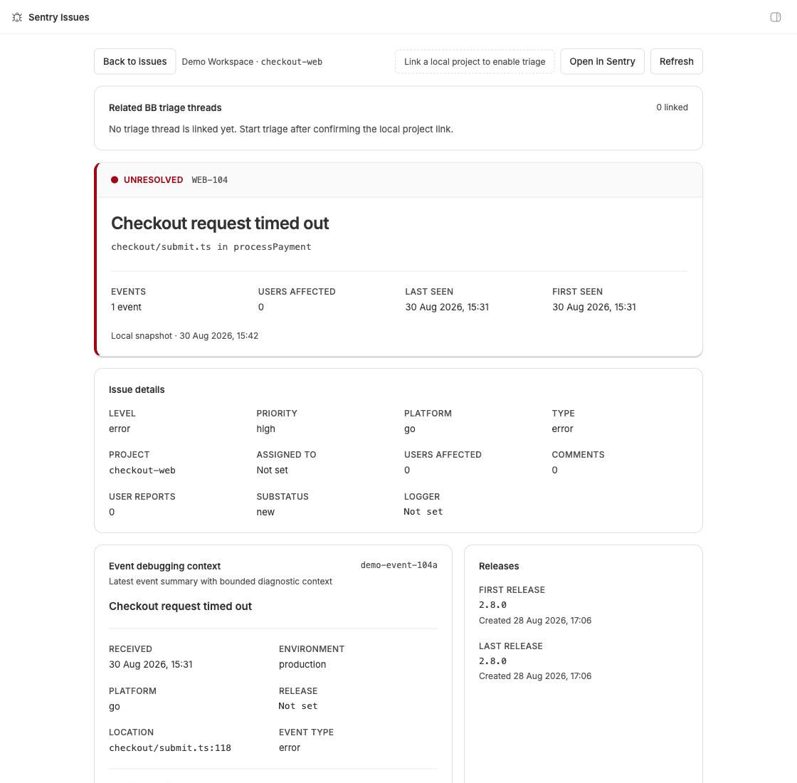
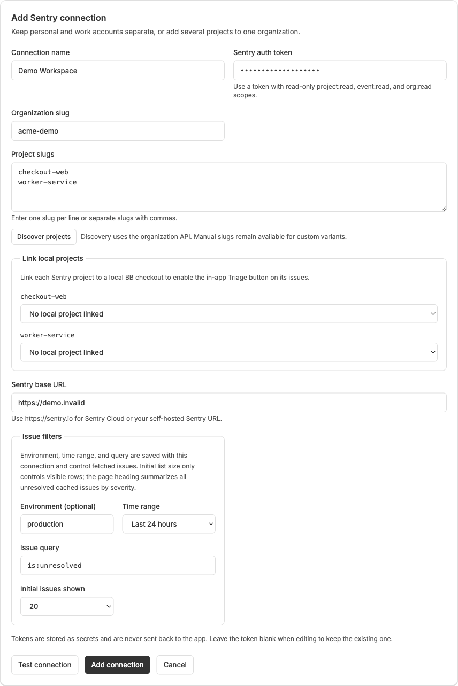

# Sentry Issues for bb

Read-only Sentry issue browser for bb. It adds a **Sentry Issues** sidebar
panel and fetches issues from one or more configured Sentry connections.

## Showcase

These screenshots use synthetic Demo Workspace data and contain no customer
projects, issue identifiers, tokens, or Sentry URLs.







## Configure

After installation, the Sentry Issues panel opens with an inline setup form.
Create separate named connections for personal and work accounts, or put
multiple project slugs under one organization:

- connection name and Sentry base URL
- an auth token with read-only `project:read`, `event:read`, and `org:read` scopes
- organization slug
- one or more project slugs, entered one per line or comma-separated
- environment, time range, issue query, and initial visible list size

The inbox defaults to showing unresolved issues. An empty Issue query fetches
all statuses so the status filter can switch between unresolved, resolved,
ignored, or all. Each connection stores its own filters, so personal and work
connections can use different environments, time ranges, or queries. Leave
Environment and Issue query empty to include everything.

Select **All projects** to aggregate every configured connection and project.
Aggregated rows retain their connection, organization, and project identity,
and issue routes include that identity so equal Sentry issue IDs cannot collide
across accounts or projects.

```sh
# From the directory that contains this checkout:
bb plugin install ./bb-sentry-issues

# Or, from inside this checkout:
bb plugin install .
```

Use **Edit connection** to add projects later without re-entering the token,
change filters, or update the base URL. **Discover projects** follows Sentry's
cursor pagination up to 500 projects and loads them into selectable checkboxes.
If Sentry omits a usable cursor, repeats a cursor, or reaches the safe page
bound, the form explicitly says the discovered list may be incomplete; manual
slugs remain available for self-hosted or older Sentry APIs where discovery is
unavailable.
**Test connection** validates the token's access to the organization and each
configured project without returning or logging the token.

Connection metadata is kept in the plugin store, while tokens remain in BB's
protected secret storage; the managed secret backing field in plugin settings
should not be edited directly. The settings and Issues views show whether a
connection is not checked, healthy, partially failing, or unavailable,
including its last successful sync, last failure, and failed project targets.
A token being present only means the connection is configured, not that it is
live. **Remove connection** requires explicit confirmation and deletes the
protected token, metadata, health record, cached issues, cached details, and
local project links.

Issue snapshots are persisted in SQLite per connection, project, and filter
set. Refreshes fetch bounded pages and **Load more** follows Sentry's cursor
until the per-target cache ceiling of 500 issues; duplicate issue IDs are
upserted instead of growing the cache. Issue detail rows are capped at 100 per
connection/project/filter target. A full page without a usable cursor, failed
target, or partial refresh stays marked incomplete and surfaces the existing
attention state. The Issues page heading displays unresolved cached issues in
three separate icon badges: Error (fatal and error), Warning (warning), and
Info (info, debug, or unknown) across all configured targets, independent of
the selected view. The sidebar accessory only shows **New** when a sync finds
an unresolved issue ID that was not in the previous snapshot; it clears on the
next successful sync after that issue is already part of the saved snapshot.

Issue detail fetches up to 10 recent events and attempts the Sentry project event
detail endpoint for the latest event. Exception values and frames, breadcrumbs,
request, contexts, user, SDK, and extra data are normalized recursively,
redacted for PII and sensitive keys, and bounded before storage or display.
Large stack, breadcrumb, and data sections stay collapsed or scroll within a
fixed height. If an event list or detail endpoint is unavailable, the issue
page keeps the latest summary and explains the fallback; selecting another
recent event makes the same bounded detail request when supported.

Triage requires a linked local BB project with a local checkout. The first
**Triage** action for an issue reopens its persisted linked thread; starting a
new run is explicitly confirmed and preserves earlier links. Triage uses BB's
`accept-edits` permission mode, and the confirmation explains that the host
must approve filesystem changes. Related threads are stored in SQLite, shown
on the issue page, and removed with the connection's cached artifacts.

The BB composer also provides a native @ mention provider for cached Sentry
issues. Search is cache-backed to stay within the composer time budget; resolving
a picked issue refreshes its read-only normalized context when possible and
passes only bounded redacted data to the agent. No Sentry token is included.

The plugin only makes bounded `GET` requests to Sentry and stores normalized
issue snapshots for offline/read-through fallback. HTTPS is required for
remote Sentry URLs; plain HTTP is accepted only for localhost, 127.0.0.1, or
::1 development endpoints. Response bodies are capped at 512 KiB, normalized
strings at 1,000 characters, nested values at bounded depth and entry counts,
issue caches at 500 items per target, detail caches at 100 rows per target, and
RPC outputs at their contract limits. Email addresses, IPv4/IPv6 addresses,
sensitive fields, sensitive tag keys/values, URL credentials/query secrets,
bearer-like values, and URL fragments are redacted before issue data reaches
the UI or agent context. Tokens are never returned or logged.

No resolve, ignore, assign, comment, or other Sentry mutation controls are
exposed. The current token contract and implementation are read-only; adding a
mutation would require verified token scopes, endpoint support, confirmation
UX, and post-write cache reconciliation.

Project discovery uses Sentry's
[organization projects API](https://docs.sentry.io/api/organizations/list-an-organizations-projects/);
tokens without the required organization scope, self-hosted deployments, and
older API variants can return an unsupported/forbidden response, which is why
manual project entry remains the fallback.

The project issues endpoint used for 24-hour and 14-day focused queries is
deprecated by Sentry and remains for compatibility with deployments that
support it; longer time ranges use the organization issues endpoint. Sentry
deployments that omit a usable pagination Link cursor are reported as
incomplete rather than being presented as complete.

## Development

```sh
npm install --include=dev
npm run check
npm test
npm run build
```
