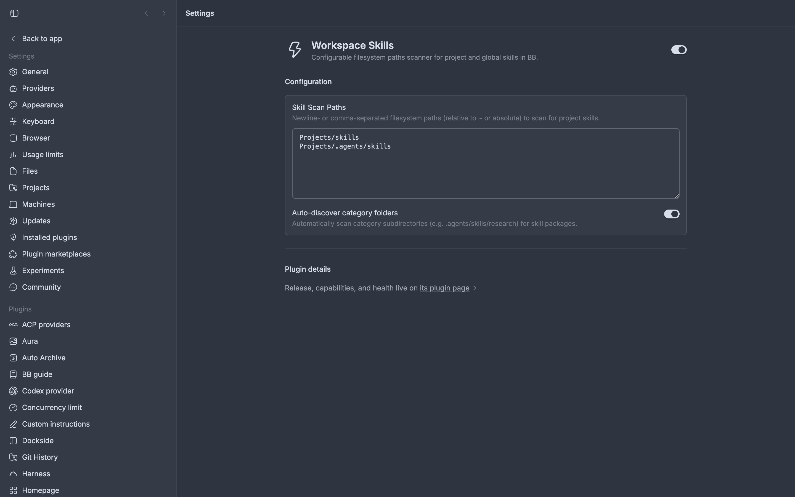

# alia-plugin-workspace-skills

Configurable filesystem scanner for project and external skills in VesnALIA.

Allows users to configure arbitrary filesystem paths (e.g. `Projects/skills`, `Projects/.agents/skills`) in VesnALIA Settings or via CLI, automatically discovers skill packages, registers them into VesnALIA's shared skill roots (`~/.vesnalia/config.json`), and reloads VesnALIA on the fly.



## Features

- **No Hardcoded Paths**: Configurable via VesnALIA Settings UI (**Settings → Plugins → Workspace Skills**) or CLI.
- **Deep Category Discovery**: Automatically detects nested skill folders (e.g. `.agents/skills/research/*`).
- **Single Source of Truth**: Skills remain in their original git repositories — no file copying or symlinking.
- **Universal Availability**: Discovered skills appear in the `/` slash menu across all projects, personal scratch threads, and for all agents (Antigravity ACP, Claude Code, Codex, Cursor, etc.).
- **Built-in CLI**: `alia workspace-skills status`, `alia workspace-skills sync`, `alia workspace-skills add <path>`.

## Quickstart

### Installation

```bash
# Install via Git (auto-tracks compatible semver releases):
alia plugin install git:https://github.com/VanDalkvist/bb-plugin-workspace-skills.git@^0.1.0 --yes

# Or install from local path:
alia plugin install /path/to/alia-plugin-workspace-skills --yes
```

### Configuration

Via CLI:
```bash
alia plugin config workspace-skills set scanPaths "Projects/skills\nProjects/.agents/skills"
alia plugin config workspace-skills set autoDiscover true
```

Or open **Settings → Plugins → Workspace Skills** in the VesnALIA desktop app.

### CLI Commands

```bash
# Check status and discovered roots
alia workspace-skills status

# Force rescan and reload
alia workspace-skills sync

# Add a path to scan
alia workspace-skills add Projects/another-repo/skills
```
