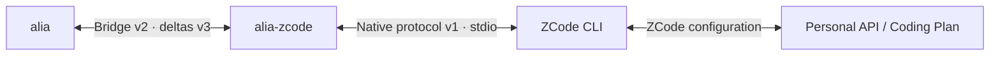

<p align="center">
  
</p>

<h1 align="center">ZCode, inside VesnALIA.</h1>

<p align="center">
  A local provider plugin for streaming replies, native tools, and resumable coding sessions.
</p>

<p align="center">
  <a href="https://github.com/dpolishuk/bb-zcode/actions/workflows/ci.yml"></a>
  <a href="LICENSE"></a>
  <a href="#compatibility"></a>
  <a href="https://www.typescriptlang.org/"></a>
</p>

<p align="center">
  <a href="#quick-start">Quick start</a> ·
  <a href="#features">Features</a> ·
  <a href="docs/configuration.md">Configuration</a> ·
  <a href="docs/validation.md">Validation</a> ·
  <a href="CONTRIBUTING.md">Contributing</a>
</p>

Bring [ZCode](https://github.com/zai-org/ZCode)'s agent into
[VesnALIA](https://github.com/get-bb/bb). Choose **ZCode** in a thread, send a prompt,
follow its work, and return to the same conversation later. The plugin runs
your installed ZCode CLI and uses its existing provider configuration.

> [!NOTE]
> Supports **individual Coding Plan sign-in in ZCode Desktop** (Z.ai / BigModel)
> and **personal API providers configured in ZCode**. Start Plan and Team plans
> are not supported yet.

## Features

|                        | What you get                                                    |
| ---------------------- | --------------------------------------------------------------- |
| **Live conversations** | Stream text and reasoning directly into VesnALIA.                     |
| **Native tools**       | Follow ZCode tool calls and results in the thread.              |
| **Human decisions**    | Answer approvals and questions through VesnALIA.                      |
| **Session continuity** | Stop, release, resume, fork and rewind conversations.           |
| **Background work**    | Track native Bash/agent tasks; list, inspect output and cancel. |
| **File rollback**      | Preview and explicitly apply native file checkpoints.           |
| **Model discovery**    | Choose from ZCode's models and reasoning options.               |
| **VesnALIA extensions**      | Enable VesnALIA plugin tools and load VesnALIA skill files.                 |
| **Custom agents**      | Configure native subagents and answer their questions in VesnALIA.    |
| **Plan mode**          | Ask ZCode to inspect the workspace and prepare a plan.          |

Each thread runs its own supervised ZCode process. The plugin reads ZCode's
existing sign-in and keeps short-lived Coding Plan credentials in memory;
there are no API-key settings to fill in or credentials to paste into VesnALIA.

## Quick start

You'll need **VesnALIA 0.46.1**, **Node.js 24+**, and a local **ZCode** installation
with individual Coding Plan connected in ZCode Desktop or a personal API provider
configured. Start VesnALIA before installing the plugin.

### Install from VesnALIA's marketplace

Open **Settings → Plugin marketplaces**, paste this into **Marketplace source**, and
click **Add**:

```text
https://raw.githubusercontent.com/dpolishuk/bb-zcode/main/marketplace.json
```

In VesnALIA's plugin store, search for **ZCode**, open the entry from **ZCode for VesnALIA**,
and click **Install**. VesnALIA downloads, builds, and manages the plugin for you.
Adding the marketplace alone does not install a plugin.

You can also paste this Git source into the same field:

```text
git:https://github.com/dpolishuk/bb-zcode.git@main
```

The plain `https://github.com/dpolishuk/bb-zcode` repository page is not a
marketplace manifest; VesnALIA 0.46.1 requires the raw JSON URL or `git:` source above.

With the VesnALIA CLI on PATH, the equivalent is:

```sh
alia marketplace add git:https://github.com/dpolishuk/bb-zcode.git@main
alia plugin install zcode@alia-zcode
```

The catalog and plugin track `main`. Use VesnALIA's native update controls or
`alia plugin update zcode` to install later compatible changes. See
[marketplace details](docs/marketplace.md) for refresh and verification.

### Install from a checkout

For local development:

```sh
git clone https://github.com/dpolishuk/bb-zcode.git
cd alia-zcode
npm ci --ignore-scripts
npm run check
node scripts/alia.mjs plugin install . --yes
```

Open a new VesnALIA thread, select **ZCode**, choose a model, and send a prompt.

### Updating for Coding Plan support

On the machine running VesnALIA, sign in to ZCode Desktop and open **Coding Plan**
once, then update the plugin and open a new VesnALIA thread:

```sh
alia plugin update zcode --yes
alia provider models zcode --json
```

The list should contain actual model names and their supported effort choices.
For example, the verified ZCode catalog exposes GLM-5.3 / GLM-5.3-Flash with
`low`, `high`, and `max`. Choices follow your installed ZCode catalog.

The installer helper uses VesnALIA's installed macOS app CLI, or `alia` on PATH on
other systems. The provider finds `zcode` on PATH, then tries the CLI bundled
in `/Applications/ZCode.app`.

<details>
<summary><strong>Using a custom ZCode or Node installation?</strong></summary>

Set the paths on the machine running your VesnALIA threads:

```sh
node scripts/alia.mjs plugin config zcode set executable /absolute/path/to/zcode.cjs
node scripts/alia.mjs plugin config zcode set nodeExecutable /absolute/path/to/node
node scripts/alia.mjs provider models zcode
```

See [configuration](docs/configuration.md) for launch arguments, environment
overrides, permission modes, and troubleshooting.

</details>

## Compatibility

| Component     | Tested with                            |
| ------------- | -------------------------------------- |
| VesnALIA            | 0.46.1                                 |
| VesnALIA plugin SDK | 0.6.49                                 |
| ZCode CLI     | 0.16.9 and 0.17.0 · native protocol v1 |
| Platform      | macOS                                  |
| CLI runtime   | Node.js 24 and 26.5.0                  |

Automated tests cover the bridge contract, streaming, approvals,
questions, cancellation, resume, account authentication, and transport failures.
An end-to-end check also passed through **VesnALIA → this plugin → the real ZCode CLI**,
using a deterministic local model fixture.

See the [validation record](docs/validation.md) for what was tested and what
remains unverified. Personal provider authentication and production model
connectivity have not been tested. Linux and Windows launch support is
implemented but has not received the same live verification.

### Current scope

- Follow-ups queue until the running turn finishes. Images, files, token/context
  reporting, and native manual compaction are supported.
- MCP servers can be configured at session startup. Official MCP authentication
  supports individual Coding Plan on the default ZCode endpoint. Native memory
  and enhanced search are optional settings; see [configuration](docs/configuration.md).
- The optional VesnALIA tool bridge retains plugin presentations and text/image
  results. VesnALIA skill catalogs point to original files; they are not added to ZCode’s native Skill catalog.
  Custom subagents and nested tool attribution are supported; Bash rows retain output.
- Native forks and conversation rewind use stable checkpoints. Background Bash/agent
  cards and task commands survive foreground settlement. File rollback has separate
  preview/apply commands; see [configuration](docs/configuration.md).
- File edits and reads, searches, web fetches, plan steps and delegations
  render as rich VesnALIA rows; full unified-diff views, cost billing and a full
  subagent tree remain unsupported.
- The provider usage panel reports account status and the Coding Plan label
  without invented numbers, and `/zcode-check` runs ZCode's native
  connectivity test with one real model request.
- VesnALIA archive and rename actions work, with names and archive state kept in
  VesnALIA (ZCode title generation stays off); clearing a thread goal calls the
  native session goal action. `/zcode-plugin` manages ZCode's own plugins
  from VesnALIA. Native scheduled tasks (Cron tools) work with the
  `automationsEnabled` setting and run while VesnALIA is open. Full unified-diff
  views, cost billing and a full subagent tree remain unsupported.
- Browser Use, interactive plugin UI, and Off-Peak/workflow host services
  need further integration; native attempts fail with a clear message
  pointing to ZCode Desktop.
- ZCode labels this session API as legacy while migrating its desktop protocol.
  Future CLI versions may require adapter changes.

See the [capability audit](docs/capability-audit.md) for the full feature matrix,
source evidence, verification limits, and recommended implementation order.

## How it works



The adapter translates the two protocols, supervises child processes, and
forwards native approval requests to VesnALIA. VesnALIA instructions are prepended to the
first prompt and retained in ZCode's saved conversation.

## Development

```sh
npm run check         # TypeScript, tests, and alia's plugin builder
npm run format:check  # Formatting
npm run test:live     # Installed ZCode CLI + isolated loopback model
```

The live test uses an isolated HOME and synthetic provider configuration. It
does not use your model credentials. CI runs the static checks and synthetic
test suite; the native CLI smoke is opt-in.

`marketplace.json` is generated from the package branding and
`PLUGIN_OVERVIEW.md`. Run `npm run marketplace:build` after changing either;
CI checks that the committed catalog stays in sync.

Contributions are welcome. Start with [CONTRIBUTING.md](CONTRIBUTING.md) and the
[configuration guide](docs/configuration.md).

## License and credits

[MIT](LICENSE) © 2026 Dmitry Polishuk.

Built on the public [VesnALIA plugin SDK](https://github.com/get-bb/bb) and
[ZCode's native protocol](https://github.com/zai-org/ZCode).
This is an independent community integration, not an official VesnALIA or ZCode plugin.
